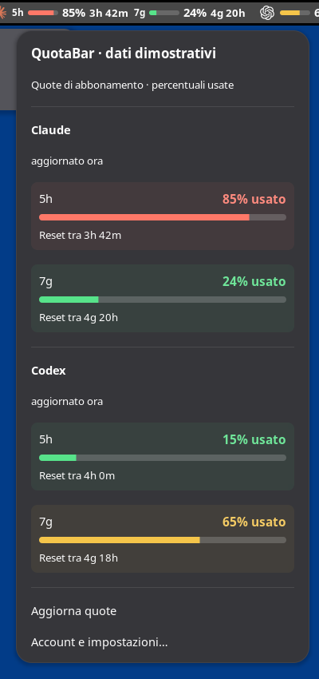

# QuotaBar

**Le quote Claude e Codex sempre visibili nella barra di GNOME.**

[English](README.md) · Italiano · [Ultima versione](https://github.com/akkaz/quotabar/releases/latest)

Barrette compatte, percentuali e tempo al reset accanto all'orologio o agli
indicatori di sistema. Un clic apre il dettaglio; le impostazioni native
permettono di collegare gli account e scegliere cosa mostrare.

**GNOME Shell 48–51**, con pacchetti nativi `.deb` per Debian/Ubuntu e `.rpm`
per Fedora Workstation. KDE Plasma non è supportato. L'interfaccia è in italiano.
La [scheda di validazione](docs/VALIDATION.md) distingue ambienti provati e limiti.

## Installa con una riga

```bash
curl -fsSL https://raw.githubusercontent.com/akkaz/quotabar/main/install.sh | bash
```

L'[installer](install.sh) riconosce Debian/Ubuntu oppure Fedora, scarica il
pacchetto nativo `.deb` o `.rpm`, verifica SHA-256, nome, versione e architettura,
poi lo installa tramite `apt` oppure `dnf`.
La password viene richiesta in un popup grafico con `sudo -A`, usando
`SUDO_ASKPASS` oppure Zenity. Servono `curl`, Python 3, GNOME 48–51, il gestore
pacchetti nativo e un helper grafico per la password. Le CLI dei provider si
installano separatamente. L'installer DNF copre Fedora Workstation tradizionale;
non gestisce il layering di Fedora Atomic/Silverblue.

Dopo l'installazione:

1. Apri **QuotaBar** dal menu applicazioni oppure esegui `quotabar settings`.
2. Attiva **“Mostra nel pannello e ai prossimi accessi”** e collega gli account.
3. Se la barra non compare, esci dalla sessione e rientra quando ti è comodo.

Una volta attivata, l'estensione parte a ogni accesso. L'installer non chiude la
sessione e non modifica l'interruttore globale delle estensioni. Se hai già fatto
il login nelle CLI ufficiali, QuotaBar può usare quelle sessioni.

### Alternative

Scarica il pacchetto nativo dalle [release](https://github.com/akkaz/quotabar/releases/latest)
e aprilo con il gestore pacchetti grafico, oppure installalo così:

```bash
sudo -A apt install ./quotabar_0.4.0-1_all.deb
# Fedora Workstation:
sudo -A dnf install ./quotabar-0.4.0-1.noarch.rpm
```

I comandi manuali con `sudo -A` richiedono `SUDO_ASKPASS` configurato.

Per una versione precisa:

```bash
curl -fsSL https://raw.githubusercontent.com/akkaz/quotabar/main/install.sh | bash -s -- --version 0.4.0
```

Per scaricare e verificare senza installare:

```bash
curl -fsSL https://raw.githubusercontent.com/akkaz/quotabar/main/install.sh | bash -s -- --download-only ./quotabar-download
```

Nelle release trovi anche uno ZIP autonomo per GNOME e l'archivio dei sorgenti.
Scegli `.deb` oppure ZIP: una copia ZIP nella home ha precedenza sul pacchetto di
sistema e ne nasconderebbe gli aggiornamenti. Prima di passare dal tuo ZIP al
`.deb`, rimuovi la copia utente con `gnome-extensions uninstall quotabar@akkaz.dev`;
dopo l'installazione esci dalla sessione e rientra.

## Cosa mostra

- **Claude:** scegli **solo 5 ore**, **solo settimana** oppure **entrambe** nel pannello.
- **Codex:** una barretta, settimanale quando il provider la rende disponibile.
- Loghi dei provider, percentuali e conto alla rovescia al reset.
- Menu con limiti più grandi, sfondi leggermente colorati, eventuali quote per
  modello e momento dell'ultima lettura riuscita.
- Impostazioni per posizione, provider, loghi o nomi, barrette, percentuale usata
  o residua, conto alla rovescia, intervalli di lettura e colori delle quote.
- Modalità **DEMO**, senza account e senza richieste ai provider.

<p align="center"></p>
<p align="center"><em>Cattura reale su GNOME 48 con numeri dimostrativi, indicati come DEMO.</em></p>

Il colore segue sempre la **quota rimanente**, anche se scegli di visualizzare
la percentuale usata. Nella scheda **Aspetto** puoi scegliere un colore per ogni
stato o ripristinare i colori automatici, adattati al tema. Questi sono i valori predefiniti:

| Quota rimanente | Colore |
| --- | --- |
| Oltre il 50% | Verde |
| Sopra il 20% e fino al 50% | Giallo |
| 20% o meno | Rosso |

Vengono mostrate soltanto le finestre effettive del provider. Non viene inventato
un secondo limite per chi ne ha uno solo. Nel menu le percentuali sono sempre
quelle **usate**.

## Account e aggiornamento

Installa le CLI ufficiali [Codex](https://developers.openai.com/codex/cli/) e/o
[Claude Code](https://code.claude.com/docs/en/setup). Nelle impostazioni premi
**“Collega”**: si apre la CLI in un terminale, con il suo login nel browser.
Completa l'eventuale verifica nel terminale e aggiorna le quote.

Servono **abbonamenti ai provider**, non chiavi API a consumo. Non esiste un
account QuotaBar e non vengono usati proxy o servizi intermedi.

| Provider | Intervallo predefinito | Origine dei dati |
| --- | --- | --- |
| Codex | 60 secondi | Protocollo ufficiale app-server locale |
| Claude | 180 secondi | Endpoint OAuth di utilizzo non documentato |

Il conto alla rovescia si aggiorna localmente ogni 10 secondi. Le quote vengono
lette periodicamente: non è un flusso push. L'aggiornamento manuale rispetta gli
intervalli minimi e il rallentamento dopo errori o limiti del provider. Le CLI
possono restare chiuse finché le loro credenziali sono valide.

Le quote riguardano l'intero account: includono anche l'uso da un altro PC o
dalla VM. Se una lettura fallisce o è troppo vecchia, le percentuali vengono
nascoste fino al prossimo aggiornamento riuscito. Quando Claude Code rinnova il
login, QuotaBar rileva il cambiamento e riprova subito dopo un errore di
autenticazione, rispettando comunque i limiti HTTP 429 del provider. Puoi
impostare l'intervallo Claude a 60 secondi nelle preferenze: non è un flusso push
istantaneo dal server.

**Claude:** l'endpoint utilizzato non è una API pubblica documentata e può
cambiare o smettere di accettare il client. QuotaBar legge la sessione di Claude
Code senza modificarla né rinnovarne le credenziali. Se scade, apri Claude Code
o ripeti il login. Restano applicabili le condizioni di autenticazione e uso dei
provider; QuotaBar è un progetto indipendente.

## Privacy

Nessuna telemetria e nessun backend QuotaBar. Non vengono letti prompt o
conversazioni, né effettuate chiamate ai modelli per ottenere le quote.
Le credenziali restano nei percorsi delle CLI ufficiali; QuotaBar non le inserisce
in log, cache, JSON di utilizzo o pacchetti distribuiti. La cache locale contiene
letture e timestamp con permessi privati. Le richieste Claude non seguono redirect
con il token. Non vengono modificati hook, statusline o configurazioni delle CLI.

Una lettura fallita conserva il dato precedente soltanto nella cache privata
per il recupero; non lo mostra come percentuale attuale nella barra o nel menu.
Per i dettagli tecnici e i controlli eseguiti vedi [VALIDATION.md](docs/VALIDATION.md).

## Aggiornamenti e problemi comuni

**Per aggiornare**, esegui di nuovo l'installer. Su GNOME/Wayland il nuovo codice
si carica al prossimo logout/login: spegnere e riaccendere l'estensione non
svuota la cache dei moduli. Puoi continuare a lavorare e uscire più tardi.
**“Aggiorna quote”** aggiorna i numeri, non il codice dell'estensione.

**La barra non compare:** verifica nell'app Estensioni che le estensioni GNOME
siano abilitate, attiva QuotaBar nelle sue impostazioni ed esci/rientra se lo
hai appena installato. QuotaBar non riattiva globalmente le altre estensioni.

**GNOME non compatibile:** controlla `gnome-shell --version`. La sola versione
di Ubuntu non basta. Il supporto per altri GNOME richiede verifiche e modifiche
al codice, non soltanto ai metadati.

**Compare `!` o i numeri non cambiano:** apri il menu per l'errore e l'ultima
lettura riuscita. Controlla la rete, rinnova il login se serve e attendi la fine
dell'eventuale backoff. Un limite non disponibile compare come `—`, non come 0%.

**Manca l'helper della password:** installa Zenity dal gestore pacchetti,
configura `SUDO_ASKPASS` oppure usa il `.deb` con il gestore grafico.

Per disinstallare usa il gestore pacchetti grafico, oppure:

```bash
gnome-extensions disable quotabar@akkaz.dev
sudo -A apt remove quotabar
```

Esci/rientra per scaricare il codice già caricato da GNOME. Le CLI e le loro
credenziali restano al loro posto; impostazioni e cache QuotaBar vengono conservate.

## Sviluppo e licenza

```bash
git clone https://github.com/akkaz/quotabar.git
cd quotabar
/usr/bin/python3 scripts/check.py
/usr/bin/python3 scripts/build.py
```

GJS/St per la barra, GTK 4/Libadwaita per le impostazioni, Python con sola libreria
standard per l'helper. Nessuna dipendenza npm/pip. Il build non richiede root;
produce `.deb`, ZIP, archivio sorgenti e `SHA256SUMS` in `dist/`.
Dipendenze e modalità di contribuzione: [CONTRIBUTING.md](CONTRIBUTING.md).

Codice con licenza [MIT](LICENSE). Loghi e attribuzioni in
[THIRD_PARTY_NOTICES.md](THIRD_PARTY_NOTICES.md). Nessuna affiliazione con OpenAI o
Anthropic. Implementazione originale: [AI Limits](https://github.com/ilysenko/ai-limits-gnome)
è stato consultato come riferimento tecnico; nessun suo file è stato copiato.
