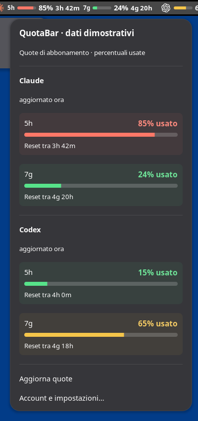

<p align="center"></p>
<h1 align="center">QuotaBar</h1>
<p align="center">Your Claude and Codex quotas, right in the GNOME top bar.</p>
<p align="center">
  <a href="https://github.com/akkaz/quotabar/releases/latest"></a>
  <a href="https://github.com/akkaz/quotabar/actions/workflows/ci.yml"></a>
  <a href="LICENSE"></a>
  
</p>
<p align="center">English · <a href="README.it.md">Italiano</a></p>

Keep an eye on your subscription limits while you work. QuotaBar adds small,
color-coded meters and reset countdowns beside the clock or system indicators.
Click them for a larger view, or open native settings to connect accounts and
choose what appears.

**For GNOME Shell 48.** Tested on Ubuntu 25.04. Other GNOME versions and KDE are
not supported yet. The application interface is currently in Italian.

## Install in one line

```bash
curl -fsSL https://raw.githubusercontent.com/akkaz/quotabar/main/install.sh | bash
```

The [installer](install.sh) fetches the latest published `.deb`, verifies its
SHA-256 checksum and package identity, then installs it through `apt`. A graphical
password prompt uses `sudo -A`, with your `SUDO_ASKPASS` helper or Zenity.
You need `curl`, Python 3, GNOME 48, `apt`, and a graphical password helper.
The provider CLIs are installed separately.

Then:

1. Open **QuotaBar** from Applications, or run `quotabar settings`.
2. Enable **“Mostra nel pannello e ai prossimi accessi”** and connect your accounts.
3. If the indicator does not appear, log out and back in when convenient.

Once enabled, QuotaBar starts with your GNOME session. The installer never logs
you out or changes the global extension switch. Already signed into the official
CLIs? QuotaBar can reuse those sessions.

<details>
<summary>Manual install, a specific version, or download without installing</summary>

Download the `.deb` from [Releases](https://github.com/akkaz/quotabar/releases/latest)
and open it with your graphical package installer, or install it from Downloads:

```bash
sudo -A apt install ./quotabar_0.3.0-1_all.deb
```

Manual `sudo -A` commands assume you have configured `SUDO_ASKPASS`.

Pin a release:

```bash
curl -fsSL https://raw.githubusercontent.com/akkaz/quotabar/main/install.sh | bash -s -- --version 0.3.0
```

Download and verify without installing anything:

```bash
curl -fsSL https://raw.githubusercontent.com/akkaz/quotabar/main/install.sh | bash -s -- --download-only ./quotabar-download
```

Releases also contain a self-contained extension ZIP and a source archive.
For a ZIP installation, run `gnome-extensions install` on the downloaded ZIP,
log out and back in, then enable `quotabar@akkaz.dev`.

Use either the `.deb` or the ZIP. A user-installed ZIP takes priority over system
packages and would hide `.deb` updates. Remove the user copy with
`gnome-extensions uninstall quotabar@akkaz.dev` before switching to the `.deb`;
then log out and back in after installation.

</details>

## What you see

- **Claude:** choose **5 hours**, **weekly only**, or **both** in the panel.
- **Codex:** one meter, using the weekly limit when the account provides one.
- **Provider logos**, percentages, and a countdown to the next reset.
- **A detailed menu** with larger meters, matching tints, model-specific limits
  when available, and the age of the last successful reading.
- **Native settings:** position, visible providers, logos or names, bars,
  countdowns, used or remaining percentages, refresh intervals, and custom quota colors.
- **Demo mode:** try the interface without accounts or provider requests.

<p align="center"></p>
<p align="center"><em>Actual GNOME 48 capture with synthetic data, explicitly marked DEMO. “7g” means seven days.</em></p>

Colors always describe **remaining quota**, even if you choose to display the
used percentage. In **Appearance / Aspetto**, choose a color for each state or
restore automatic theme-aware colors. The table shows the defaults:

| Remaining quota | Color |
| --- | --- |
| More than 50% | Green |
| More than 20%, up to 50% | Amber |
| 20% or less | Red |

Only real quota windows are shown. QuotaBar does not invent a second limit for
accounts that expose only one. The popup always labels its numbers as **used**.

## Connect your accounts

Install the official [Codex CLI](https://developers.openai.com/codex/cli/) and/or
[Claude Code](https://code.claude.com/docs/en/setup). In QuotaBar settings, click
**“Collega”** beside the provider. This opens the official CLI in a terminal and
its browser login flow. Complete any verification there, then refresh the quotas.

QuotaBar uses **subscription accounts**, rather than metered API keys. There is
no QuotaBar account, proxy service, or separate credential store.

### How fresh are the numbers?

| Provider | Default polling interval | Data source |
| --- | --- | --- |
| Codex | 60 seconds | Official local app-server account protocol |
| Claude | 180 seconds | Read-only, undocumented OAuth usage endpoint |

Countdowns update locally every 10 seconds. Usage is polled, not pushed. Manual
refresh respects minimum request intervals and provider backoff after errors.
Polling can continue while the provider CLIs are closed, as long as their
credentials remain usable.

**Claude integration:** its usage endpoint is not a documented public API and
may change or stop accepting this client. QuotaBar reads the Claude Code session
without rewriting or refreshing its credentials. If that session expires, open
Claude Code or sign in again. The providers' own authentication and usage terms
still apply; QuotaBar is an independent project.

## Privacy and behavior

- No telemetry, analytics, or QuotaBar backend.
- No prompts, conversations, or model calls are needed to read the quotas.
- Credentials stay in the official CLIs' existing stores. QuotaBar does not include
  them in logs, usage JSON, the cache, or release artifacts.
- A local cache stores quota readings and timestamps with private file permissions.
- Failed reads retain the last successful reading, visibly marked as stale.
- Claude HTTP requests do not forward credentials through redirects.
- No changes to CLI hooks, status lines, or provider configuration.

Codex reads use `initialize`, `account/read`, and `account/rateLimits/read`
through a short-lived `codex app-server` process. Claude uses
`https://api.anthropic.com/api/oauth/usage`. See [VALIDATION.md](docs/VALIDATION.md)
for implementation and verification details.

## Updates and troubleshooting

**Update:** run the same one-line installer again. On GNOME/Wayland, updated
JavaScript is loaded after your next logout/login. Disabling and re-enabling the
extension does not clear GNOME's module cache. **“Aggiorna quote”** refreshes
account data, not extension code; you can keep working and log out later.

**The indicator is missing:** check that GNOME extensions are enabled in the
Extensions app, enable QuotaBar in its settings, and log out/in if it was just
installed. QuotaBar does not enable every extension globally.

**The installer says GNOME 48 is required:** check `gnome-shell --version`.
Ubuntu's version alone does not establish compatibility. Supporting another
Shell version needs testing and code changes, not just a metadata edit.

**A `!` appears, or numbers stop changing:** open the menu for the error and
last-success time. Check connectivity, renew the provider login if needed, and
allow rate-limit backoff to expire. An unavailable limit is shown as `—`, not 0%.

**No graphical password helper:** install Zenity through your package manager,
configure `SUDO_ASKPASS`, or use the `.deb` with a graphical package installer.
QuotaBar never bypasses the password prompt.

**Remove QuotaBar** through your graphical package manager, or:

```bash
gnome-extensions disable quotabar@akkaz.dev
sudo -A apt remove quotabar
```

Log out/in to unload code already cached by GNOME. Provider CLIs and their
credentials remain in place. Local QuotaBar settings/cache are retained.

## Build and contribute

GJS + GNOME Shell/St for the indicator, GTK 4/Libadwaita for settings, and a bounded
Python standard-library helper. No Electron, npm dependencies, or Python packages
to install.

```bash
git clone https://github.com/akkaz/quotabar.git
cd quotabar
/usr/bin/python3 scripts/check.py
/usr/bin/python3 scripts/build.py
```

Build requirements: Python 3.10+, GJS, GTK 4.10+, Libadwaita 1.4+,
`glib-compile-schemas`, and `dpkg-deb`. A GNOME 48 session is needed to run the
indicator, but not to build its packages. Builds require no root privileges.

Outputs in `dist/`: `.deb`, self-contained extension ZIP, source `.tar.gz`, and
`SHA256SUMS`. CI runs the tests, checks the installer, and builds the packages.
See [CONTRIBUTING.md](CONTRIBUTING.md) and the [changelog](CHANGELOG.md).

## License and acknowledgements

[MIT](LICENSE) for QuotaBar code. Provider marks are separately attributed in
[THIRD_PARTY_NOTICES.md](THIRD_PARTY_NOTICES.md); their trademark rights belong to
the respective owners. This project is not affiliated with OpenAI or Anthropic.

QuotaBar is an original implementation. [AI Limits](https://github.com/ilysenko/ai-limits-gnome)
was consulted as a technical reference for response schemas and polling behavior;
no source files were copied into QuotaBar.
